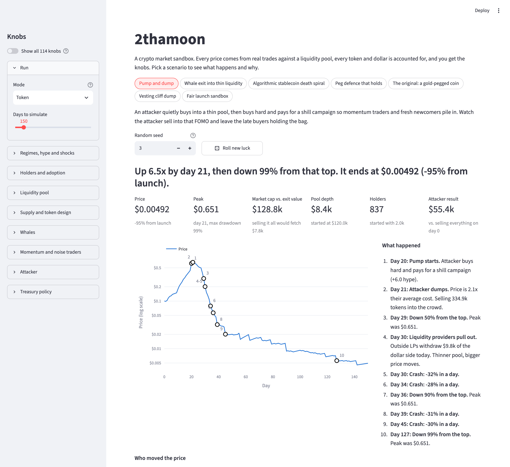
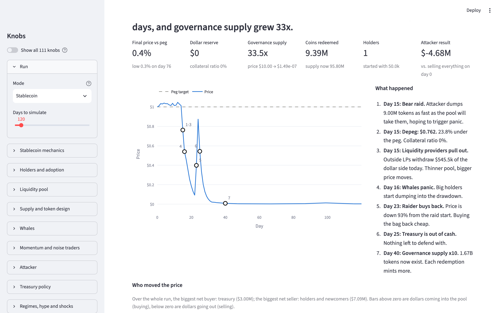
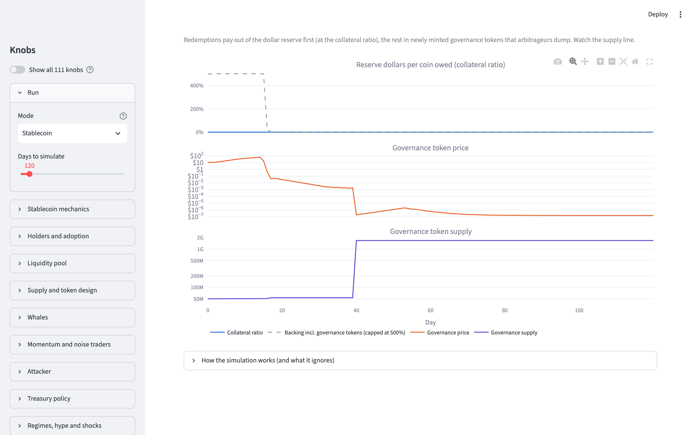
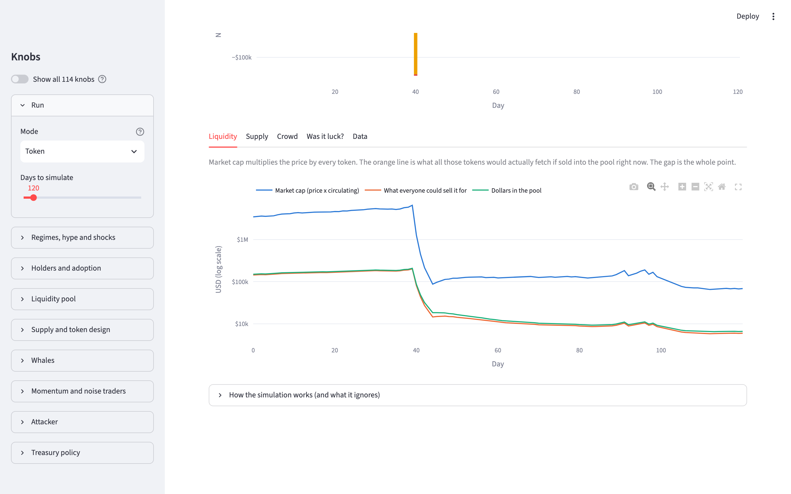
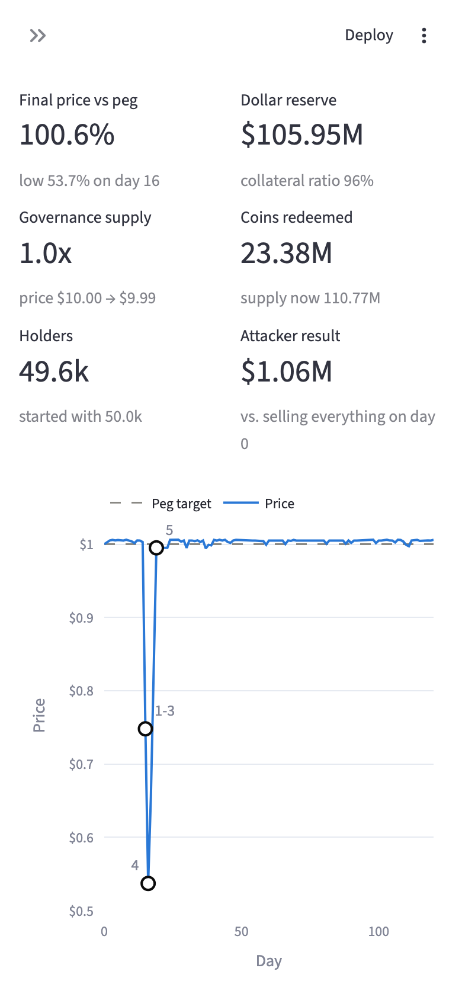

# 2thamoon - a crypto sandbox simulator

**Try it:** **https://2thamoon.streamlit.app/**

Simulate the mess. 2thamoon lets you crank the knobs on hype, liquidity, whales, attackers, market regimes and treasury policy to watch a token rip, stall, or implode. There are 139 knobs, and every one of them is wired to something real now.



---

hi guys. so im studying biz so i decided i wanna learn about crypto and how markets work. I'll be honest i didnt know shit about them so i decided to hand the project off to codex with my specs. I have read over the code a few times but its very vibe coded i want to preface with that. however its not vibe tested, ive used it and iterated on it a ton. There are so so so many things to mess with. from modifying growth, to algos, to making a stable coin, to defending against pump and dumps, to causing pump and dumps, so so much. this is not a game however, its a literal simulator. imo its really fun.

it started off as a way for me to sim a stable coin pegged to gold via an algo. that idea is still in here as its own scenario, but you can do way more with it now.

### the v2 rewrite (nov 2026)

the original was one 7,700 line `app.py` and, real talk, the math underneath was mostly vibes. prices came from a pile of hand tuned formulas instead of actual trades, and money kind of appeared out of nowhere (the default attacker turned $5.5M into $9.8 *trillion*, lmao). so v2 rebuilt the simulation from scratch on stuff a markets person wouldnt laugh at, kept the fun and the absurd number of knobs, and split it into a real python package with tests. the rewrite was done with claude. receipts for everything wrong with v1 are [further down](#what-was-wrong-with-v1).

## quick start

```
python3 -m venv .venv
source .venv/bin/activate
pip install -r requirements.txt
streamlit run app.py
```

on Windows (PowerShell), with Python 3.13 installed:

```powershell
py -3.13 -m venv .venv
.\.venv\Scripts\python.exe -m pip install -r requirements.txt
.\.venv\Scripts\python.exe -m streamlit run app.py
```

Python 3.10.0 has a [dataclass bug](https://github.com/python/cpython/issues/88815) that breaks current test tools; use 3.10.1 or newer for development.

then pick a scenario at the top. it runs instantly and tells you what happened.

## scenarios

each one loads with one click (or a link). they are just presets of the normal knobs, so you can poke at anything they do.

| scenario | what to watch |
|---|---|
| [**Pump and dump**](https://2thamoon.streamlit.app/?scenario=pump_and_dump) | An attacker quietly buys into a thin pool, then buys hard and pays for a shill campaign so momentum traders and fresh newcomers pile in. Watch the attacker sell into that FOMO and leave the late buyers holding the bag. |
| [**Whale exit into thin liquidity**](https://2thamoon.streamlit.app/?scenario=whale_exit) | One whale owns 8% of the supply and decides to cash out over five days into a pool with only $150k of dollars in it. Watch how little the whale actually gets compared to the paper value of the bag, and how the crash scares the LPs and the crowd into making it worse. |
| [**Algorithmic stablecoin death spiral**](https://2thamoon.streamlit.app/?scenario=death_spiral) | A stablecoin backed only by its own governance token (Terra style) pays 19.5% yield, and a two-day raid starts on day 15 with 9% of launch supply. Watch arbitrageurs redeem coins for freshly minted governance tokens and dump them, which crashes the backing, which makes holders run, which mints even more, until governance payouts fail permanently. |
| [**Peg defence that holds**](https://2thamoon.streamlit.app/?scenario=peg_defense) | Same coin, same yield, same day-15 attack, but every coin is backed by a full dollar in reserve and redemptions pay out in those dollars. Watch the price dip, arbitrageurs redeem against the reserve, and the peg snap back while the governance token barely notices. |
| [**The original: a gold-pegged coin**](https://2thamoon.streamlit.app/?scenario=gold_peg) | This is where 2thamoon started: a coin that tracks the price of gold, fully backed, but backed in dollars. Watch the collateral ratio: when gold rallies the coin's liabilities grow and the dollar reserve does not, so a fully backed coin quietly becomes an under-backed one. |
| [**Vesting cliff dump**](https://2thamoon.streamlit.app/?scenario=unlock_cliff) | A hyped token rides a bull market while 30% of supply sits locked for the team and early investors. Watch the day-120 cliff hand insiders a quarter of their bag at once, and how steady insider selling turns a chart that only went up into a slow bleed. |
| [**Fair launch sandbox**](https://2thamoon.streamlit.app/?scenario=sandbox) | A small token launches into a $250k pool with real holders, whales, insiders on a vesting schedule, and a market that drifts between bull and bear. Watch who is buying and selling each day, then change the seed: the same rules can moon or die on luck alone. |

the unlock-cliff preset uses a 600-day average bull regime (formerly 400) so the expanded seeds 0–9 checks keep the run-up visible before the cliff, including seed 6; no engine rules or scenario assertions were weakened.

the two stablecoin scenarios are identical except for two knobs (reserve ratio and collateral ratio), and a test enforces that. same coin, same attack, opposite endings. thats the whole lesson of terra in one toggle. fun side quest: give the death spiral an $8M defence fund instead of $3M and it survives roughly a third of seeds.





## what you see after a run

- a one line headline and the key numbers (price, peak, market cap vs what you could actually sell for, pool depth, holders, attacker result)
- the price chart with numbered dots for the events that mattered, matched to a "what happened" list, plus green/red bands for bull/bear markets
- **who moved the price**: net dollars each group put into or pulled out of the pool every day. this is the chart that explains everything
- tabs for liquidity, supply, crowd mood, peg mechanics (stablecoins), the attacker, a **was it luck?** check that reruns your exact knobs under 30 other seeds, and the raw data (csv) plus knob import/export (json)

the knobs live in the sidebar. by default you see the ~40 that matter most for the mode you are in; one toggle shows the other ~70.





## how the sim works

one step is one day. everything below is in `moonsim/engine.py`.

**price formation.** there is one constant-product liquidity pool (x * y = k, like uniswap v2) holding the token and dollars. the price is the ratio of the reserves and nothing else sets it. every trade goes through the pool, pays a 0.3% fee that stays in the pool, and gets real slippage, so a thin pool moves a lot and a whale cant sell a $1.5M bag for $1.5M. i picked an AMM over an order book because thats where new tokens actually trade, liquidity depth is an explicit number you can read off the reserves, and it conserves everything by construction.

**agents.** each one trades with money it actually has:

- **holders**: the crowd. newcomers arrive along a [Bass diffusion](https://en.wikipedia.org/wiki/Bass_diffusion_model) adoption curve (discovery + word of mouth), boosted by hype, bull markets and recent gains, and bring real cash. holders keep a target share of their wallet in the token that rises with conviction; conviction moves with gains, hype, the regime and a buy-the-dip instinct, and drops (faster) with fear from drawdowns, depegs and shocks. scared people churn, sell their share and take their cash out.
- **momentum traders**: buy when the fast moving average is above the slow one, sell when it isnt. they are why pumps overshoot.
- **noise traders**: random two-sided flow, for volume and texture.
- **whales**: take profit far above their (cheap) entry, panic in deep drawdowns, and one can be scripted to exit on a given day.
- **insiders**: receive vesting tokens (cliff, then linear) and sell a slice every day.
- **liquidity providers**: outside LPs pull liquidity when volatility or drawdowns get scary and sell part of what they withdraw. the treasury owns the rest of the pool and never flees.
- **attacker**: pump and dump (accumulate, pump with paid hype, dump into the FOMO with a slippage limit), bear raid (dump a bag, buy back lower), or your own manual order list.
- **arbitrageurs**: only matter when the protocol quotes a price (stablecoin mint/redeem). they trade only when the round trip is profitable after fees and slippage, including dumping any governance tokens they receive.
- **treasury**: can defend a price floor, sell above a ceiling, run buybacks (optionally burning), trip a circuit breaker, or in stablecoin mode spend a defence fund buying below the peg.

traders set slippage limits (calm people split orders, panicking people eat a lot of slippage, FOMO buyers eat more when hype is high), which is what keeps a $5M crowd from teleporting a $250k pool around in one order.

**stablecoin mode.** the coin has a peg (a dollar, or a simulated gold price). redeeming one coin pays its peg value: the collateral-ratio share in reserve dollars and the rest in freshly minted governance tokens priced off their own pool (FRAX v1 style; collateral ratio 0 is Terra style). minting works the other way: dollars into the reserve plus governance tokens bought and burned. holders in this mode love yield and fear depegs and thin backing, where "backing" counts the governance token's market cap the way people actually did. a daily redemption cap limits how fast arbitrage can work.

**governance failure.** a governance price below $1e-12, either governance pool reserve below 1e-9 (tokens or dollars), or a redemption that would push outstanding governance supply above 1e24 permanently fails the protocol. these are explicit economic cutoffs before floating-point exhaustion, not floors: reserves and price are never reset. governance trading freezes at its last reserves, its market cap stops counting as backing, governance issuance and dependent minting stop. redemptions can still burn coins for the lesser of their promised collateral share and their pro-rata share of remaining reserve dollars, with no governance payout; the redeemer bears the shortfall. collateral-only arbitrage can continue when profitable, and the stablecoin keeps trading so you can see the aftermath. `protocol_failed` is a boolean daily series and `protocol_failure_day` is also exposed in the result and summary. the UI marks the day in peg mechanics and the governance stat.

**supply and treasury.** emissions or staking yield are minted to holders (with optional halvings and a hard cap), a transfer tax can be split between burning and the treasury, vesting unlocks move locked tokens to insiders.

**paid promotion.** `attacker.promo_usd_per_hype` prices the requested shill campaign in dollars per hype unit (default $1,000, range $1 to $1M). it is paid once at pump start from remaining attacker cash, so an empty wallet buys zero hype and a short budget buys a smaller campaign. the dollars leave through an explicit external-spend account (`external_spend_usd`, cumulative), included in the dollar ledger. the cost reduces the attacker's cash, profit and cost-based exit trigger. the pump-and-dump preset still uses six hype units, now costing $6,000; none of its preset values needed changing.

**regimes, hype, shocks.** the market drifts between bull, sideways and bear (a markov chain with average durations you set). each regime scales adoption, newcomer budgets, mood, churn and how nervous LPs are. hype waves and macro shocks arrive at random (Poisson), hype decays with a half-life, shocks hit everyones fear.

**conservation and determinism.** every step the engine checks four ledgers: tokens (all wallets + pool + locked + burned = initial + minted), dollars (all wallets + pools = initial + newcomer cash in - churner cash out - external promotion spend), governance tokens, and LP shares. cash wallets and cumulative transfer/mint/burn totals retain low bits with constant-space Neumaier summation; conservation sums signed components together with `math.fsum` before rounding, including the token, governance and LP ledgers. it never subtracts two rounded turnover totals or adds a balancing account. the property tests throw 300 random knob combinations (both modes, any values in range) at it on every test run, in strict mode, where any drift past 1e-9 or any negative balance raises. one seeded generator drives all randomness, so the same seed and knobs, on the same platform with the same Python and NumPy versions, give identical results. Windows, Linux and macOS can differ at floating-point precision; results are not bit-identical across platforms.

**speed.** benchmarks and before/after measurements are recorded in [the correctness verification notes](docs/verification/README.md); reproduce them with `python3 scripts/bench.py`.

**output contract.** raw `result.series` has a uniform schema. in token mode, exactly `peg`, `collateral_ratio`, `backing_ratio`, `gov_price` and `gov_supply` are entirely NaN because they do not apply; `result.inapplicable_series` lists them. in stablecoin mode that list is empty and every series is finite, including after failure. `result.applicable_series`, `result.frame()` and `result.to_csv()` exclude inapplicable fields; the Data tab explains the omission. use these views for calculations, charts and exports, and use `isnan` for sentinels rather than equality. `run_many` rejects requests for an inapplicable comparison series. `protocol_failed` is always boolean (false in token mode); inactive reserve/redemption flows remain real zeros.

## what it does not model

so you dont take it too seriously:

- one pool on one venue. no order books, no CEXs, no cross-venue arbitrage for normal tokens
- no leverage, shorting, lending, liquidations or perps. raiders here cant profit from a short elsewhere, so a bear raid usually loses them money
- no MEV, gas, block-level ordering, or oracle delays. the stablecoin uses the governance pool's spot price; governance failure cutoffs are an explicit terminal policy, not a claim about a real protocol's legal insolvency or recovery
- agents are aggregated cohorts with simple rules, not people. "conviction" and "fear" are modelling devices, not measured psychology
- the default numbers are picked to make plausible, explainable stories, not fitted to any real token's history. paid promotion is a simple cash-for-hype service, not an ad auction or an empirical estimate of marketing effectiveness

it is a toy for building intuition about mechanisms (slippage, reflexivity, bank runs, unlock pressure). it does not predict anything and it is definitely not financial advice.

## what was wrong with v1

i asked for a proper audit before the rewrite. run `python scripts/audit_legacy.py` and it loads the old engine straight from git history (commit `2e4c96a`) and reproduces these numbers:

- **prices werent formed by trades.** each step added up seven hand tuned log-return terms (flow pressure, reversion to an invented "anchor", gold pull, policy pull, momentum, scarcity, noise), clipped the result, blended it with the previous price, then clamped it between 40% of a made up "fundamental" price and 2.5x the gold price. a token could never actually go to zero.
- **money appeared from nowhere.** agent "flows" were intentions that moved the price but never moved balances, and attacker trades filled at the pre-trade price with nobody on the other side. in the default run, 3,493 users holding $20.3M of capital end up with a $63.6B market cap, and 1.55M tokens appear in total supply with no mint record. the default auto-attacker turns $5.55M into $9.8 trillion.
- **double counting.** momentum, scarcity and the gold price each pushed the price through several separate terms at once.
- **dead knobs.** 19 settings (like `mint_per_new_user`, `burn_above_price`, `loss_aversion` and `allow_flash_crash`) were never read by the simulation at all. the script lists them.

v2 drops the dead and double-counted knobs, and keeps the ideas (hype, regimes, whales, attackers, treasury algos, supply design, the gold peg) on mechanics that add up.

## code base

lol remember when this section said "fuck its so bad god its just one file". it isnt anymore:

```
app.py              streamlit entry point (streamlit cloud runs this)
moonsim/            the simulation, pure python + numpy, no UI imports
  amm.py            constant-product pool
  engine.py         agents, the daily loop, events, conservation checks
  config.py         typed knobs with ranges, labels and help text
  presets.py        the scenarios
  story.py          headline, key numbers, "who moved the price"
moonsim_app/        the streamlit UI (controls are generated from config.py)
tests/              AMM, property, determinism, scenario and app tests
scripts/            legacy audit, benchmark, screenshot capture
```

```python
from moonsim import run
from moonsim.presets import get

result = run(get("death_spiral").config)
print(result.summary())
result.frame()  # pandas DataFrame of every series
```

tests: `pip install -r requirements-dev.txt && pytest`. CI runs lint, the tests, and a fresh-install boot of the app on every PR.

## final thoughts

there is so much to add and there is for sure stuff that is inaccurate. this is all done by someone who doesn't know what makes crypto work (and the more i read into it, its becoming pretty apperent that seemingly nobody does). the difference now is that when the sim says something happened, you can check exactly who traded what with whom. i think you guys should try it tho

## legal and contributing

mit license; idgaf what you do with this

in terms of prs if you decide to submit one i will read it and i will probably merge it provided it isnt like insanely buggy or something
